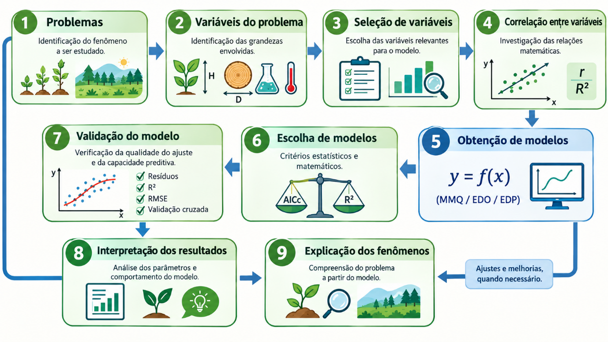

## Introdução

O Laboratório de Modelagem Matemática e Biologia Computacional da Universidade Federal do Pampa desenvolve atividades voltadas para o ensino e a aprendizagem do Cálculo Diferencial e Integral, ofertado aos cursos de Engenharia Florestal, Ciências Biológicas (Licenciatura), Ciências Biológicas (Bacharelado), Biotecnologia e Gestão Ambiental.

O estudo de variáveis e de suas relações de dependência é fundamental em qualquer área do conhecimento, pois permite compreender como um fenômeno (variável dependente) responde a determinada variável independente. Essa análise explica, por exemplo, a relação entre a altura de uma árvore e seu diâmetro à altura do peito (DAP), a proporção entre sépalas e pétalas nas flores, o crescimento de uma colônia de fungos ao longo do tempo ou a variação da temperatura em um processo de compostagem.

A formalização de funções, expressas por *y = f(x)*, representa um marco revolucionário na história da humanidade. Se o estudo das funções ilumina a compreensão dos fenômenos naturais, o Cálculo Diferencial fornece o caminho para solucionar problemas complexos e impulsionar o avanço exponencial de novas tecnologias por meio da modelagem matemática.

Segundo Bassanezi (2002), a modelagem matemática consiste em um processo dinâmico e não linear de abstração e generalização que utiliza estruturas matemáticas — como números, gráficos, tabelas e equações — para representar, analisar, interpretar e prever o comportamento de sistemas do mundo real.

Enquanto a natureza estabeleceu as condições e os fenômenos para a manutenção da vida na Terra, cabe à matemática descrevê-los quantitativamente, revelando padrões e respostas que não seriam perceptíveis apenas pela observação direta. Nessa perspectiva, a modelagem matemática permite traduzir a complexidade dos sistemas naturais em equações e simulações capazes de prever cenários futuros, otimizar o uso de recursos e subsidiar decisões mais assertivas e sustentáveis no estudo de processos matemáticos, biológicos, físicos e químicos.

Na modelagem matemática, uma abordagem para o estudo de funções e variáveis envolve a análise de correlações e a escolha de modelos (equações), utilizando principalmente o método dos mínimos quadrados. Outra abordagem utiliza equações diferenciais capazes de traduzir, a partir do conceito de derivada, como ocorre a relação de dependência entre variáveis. O processo normalmente segue o fluxo apresentado na imagem abaixo.

*Fonte: elaboração própria, com auxílio de IA generativa (OpenAI, 2026).*

A figura apresenta as principais etapas da modelagem matemática, desde a identificação do problema e a seleção das variáveis até a construção, a validação e a interpretação dos modelos para explicar fenômenos reais.

É gratificante encontrar um modelo matemático que possa ser usado para explicar a relação de dependência entre duas variáveis.

Podemos destacar, na imagem acima, duas etapas importantes: a análise de correlações entre variáveis e a obtenção de modelos, utilizando principalmente o método dos mínimos quadrados (regressão linear e não linear).

## Correlações

O estudo das correlações entre variáveis é o primeiro passo antes da formulação de modelos. Quando aceitamos que *y = f(x)*, já estamos considerando que há uma relação de dependência entre as variáveis. No entanto, há um longo caminho entre aceitar essa hipótese e verificar se *y* realmente depende de *x*. O estudo das correlações entre as variáveis ajuda a avaliar se *y* pode ser explicado a partir de *x*. Assim como podemos encontrar problemas em que há correlação entre as variáveis, também podemos encontrar situações em que não há correlação entre elas.

## Método dos mínimos quadrados

## Responsavéis

Cristhian Augusto Bugs

Diego Guimarães Nunes

Maiara de Castro Ramos

Pedro da Silva Santiago

## Referências

BASSANEZI, Rodney Carlos. **Ensino-aprendizagem com modelagem matemática: uma nova estratégia**. São Paulo: Contexto, 2002.
